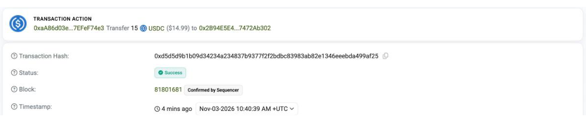
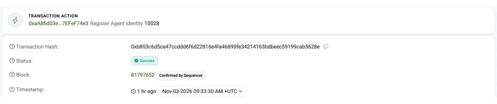
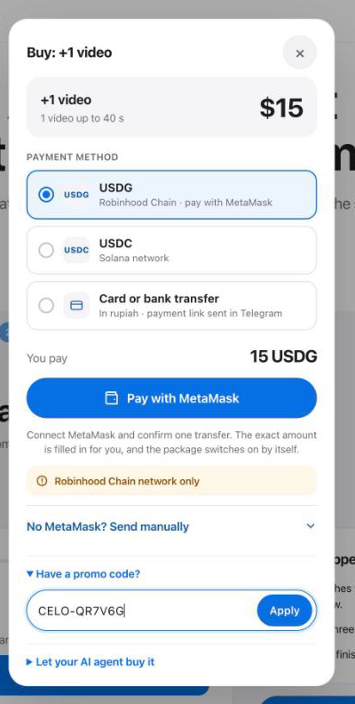

# Wayan Warrior on Celo: buy AI-made short videos with x402

[Wayan Warrior](https://wayanwarrior.pro) is an AI content agent: it researches what works in a niche on TikTok and
Reels, writes lead-generating scripts and renders videos with the client's own avatar.

This repository is its **x402 storefront on Celo mainnet**. Any AI agent or wallet can buy a Wayan package with one
HTTP request, paying **USA₮, USDT or USDC** through the official [Celo x402 facilitator](https://x402.celo.org).
Built for the Celo × Ripio *Agents on Open Rails* hackathon (track: Open Corridors, USA₮ with x402).

**Live:** https://agents.wayanwarrior.pro/catalog (Celo mainnet) · agent card:
https://agents.wayanwarrior.pro/.well-known/agent-card.json

**Buying a package (people and agents): see [BUYING.md](BUYING.md).**

## Verify on chain

| What | Celo mainnet |
|---|---|
| Agent identity: ERC-8004 agentId **10028** | registry [`0x8004A169FB4a3325136EB29fA0ceB6D2e539a432`](https://celoscan.io/address/0x8004A169FB4a3325136EB29fA0ceB6D2e539a432), registration tx [`0xb853c6d5…`](https://celoscan.io/tx/0xb853c6d5ce47ccddd6f6d22816e4fa46890fe34214163bdbeec59199cab5628e) (calldata ends with the ERC-8021 tag `celo_c0170f9f7e58`) |
| Agent wallet | [`0xaA86d03e6e8CC4C66C05c9661108f0F7EFeF74e3`](https://celoscan.io/address/0xaA86d03e6e8CC4C66C05c9661108f0F7EFeF74e3) |
| Seller (pay-to) wallet | [`0x2B94E5E4eFE0c3b4893B8e4ed4291007472Ab302`](https://celoscan.io/address/0x2B94E5E4eFE0c3b4893B8e4ed4291007472Ab302) |
| Accepted tokens | USA₮ [`0xD2ab…F771`](https://celoscan.io/token/0xD2ab3C9A02DBBAB236BfEC45D1d755DF4267F771), USDT [`0x4806…5d5e`](https://celoscan.io/token/0x48065fbBE25f71C9282ddf5e1cD6D6A887483D5e), USDC [`0xcebA…118C`](https://celoscan.io/token/0xcebA9300f2b948710d2653dD7B07f33A8B32118C) |

Sample x402 sales (15 USDC each, settled by the Celo facilitator, each one turned into a redeem code):

| Date | Buyer | Transaction |
|---|---|---|
| 2026-11-03 | our own test agent | [`0xd5d5d9b1…`](https://celoscan.io/tx/0xd5d5d9b1b09d34234a234837b9377f2f2bdbc83983ab82e1346eeebda499af25) |
| 2026-11-04 | a customer's Hermes agent | [`0x2c8ec45c…`](https://celoscan.io/tx/0x2c8ec45c8e9b026a0a211ae174aae53a046c1ad30599dabde2099655ece38edf) |
| 2026-11-05 | an external buyer's agent | [`0xfc8fba05…`](https://celoscan.io/tx/0xfc8fba057e3dbca30d1fe72d0a28ffb27efa73d631996fe3ca51c725cd760d39) |

| x402 settlement | ERC-8004 registration | Redeem on wayanwarrior.pro |
|---|---|---|
|  |  |  |

## How it works

```
agent / wallet ──GET /buy/pilot──▶ storefront ──402: price in USA₮/USDT/USDC──▶ agent
agent signs one EIP-3009 authorization (no gas) ──▶ storefront ──verify/settle──▶ Celo facilitator ──▶ Celo mainnet
storefront ──signed request──▶ wayanwarrior.pro ──▶ single-use redeem code ──▶ agent ──▶ human redeems at wayanwarrior.pro
```

| Route | Price | Paid response |
|---|---|---|
| `GET /buy/pilot` | $39 | redeem code: niche research, 3 scripts, 3 videos and a photo avatar |
| `GET /buy/topup_200` | $15 | redeem code: +1 video (200 credits) |
| `GET /catalog` | free | packages, prices, accepted tokens, pay-to address |
| `GET /.well-known/agent-card.json` | free | ERC-8004 registration file (the agent's `agentURI`) |

- **Buyer pays no gas:** the Celo facilitator settles the EIP-3009 transfer and pays gas.
- **No keys held:** the storefront never touches buyer keys; funds go straight to the pay-to wallet.
- **One payment, one code:** the code is keyed by payer + EIP-3009 nonce, so a retry returns the same code.
- **Identity:** the agent is registered in the ERC-8004 Identity Registry on Celo
  (`0x8004A169FB4a3325136EB29fA0ceB6D2e539a432`).
- **Attribution:** every transaction the agent sends carries the hackathon builder code as an ERC-8021 data suffix
  (`src/attribution.ts`).

## How to run

Requires Node.js 20.12+. The server listens on `PORT` (default **8402**).

**Demo mode, no secrets** (what a fresh clone does):

```bash
npm ci
npm test                  # offline tests: attribution suffix, prices, payment requirements, demo mode
npm start                 # http://localhost:8402/catalog
```

Without the live keys the storefront starts in demo mode: `/catalog`, `/health` and the agent card work, and
`/buy/<package>` answers `503` without asking for or taking any payment. The startup log names the missing keys.

**Live mode:** `cp .env.example .env`, fill it in, `npm start`.

| Variable | Needed for | What it is |
|---|---|---|
| `X402_NETWORK` | both | `testnet` (Celo Sepolia, default) or `mainnet` |
| `PORT` | both | listen port, default `8402` |
| `PUBLIC_URL` | both | public base URL used in the catalog and agent card |
| `X402_API_KEY` | live | Celo facilitator key from https://x402.celo.org |
| `SELLER_PAY_TO` | live | wallet that receives the stablecoin |
| `WAYAN_X402_SECRET` | live | HMAC secret shared with the Wayan server; turns a paid sale into a redeem code |
| `WAYAN_API_URL` | live | Wayan server, default `https://wayanwarrior.pro` |
| `ATTRIBUTION_TAG` | register | hackathon builder code, appended to agent transactions (ERC-8021) |
| `AGENT_ID` | optional | ERC-8004 agentId shown in the agent card |

Docker: `docker build -t wayan-x402 . && docker run -p 8402:8402 --env-file .env wayan-x402`.

Buy as an agent (a wallet holding USA₮, USDT or USDC on Celo; no CELO needed):

```bash
X402_NETWORK=mainnet PAY_TOKEN=USDC BUYER_PRIVATE_KEY=0x... STOREFRONT_URL=https://agents.wayanwarrior.pro npm run buy -- topup_200
```

Register the agent identity (agent wallet with a little CELO):

```bash
AGENT_PRIVATE_KEY=0x... X402_NETWORK=mainnet npm run register
```

## License

MIT
